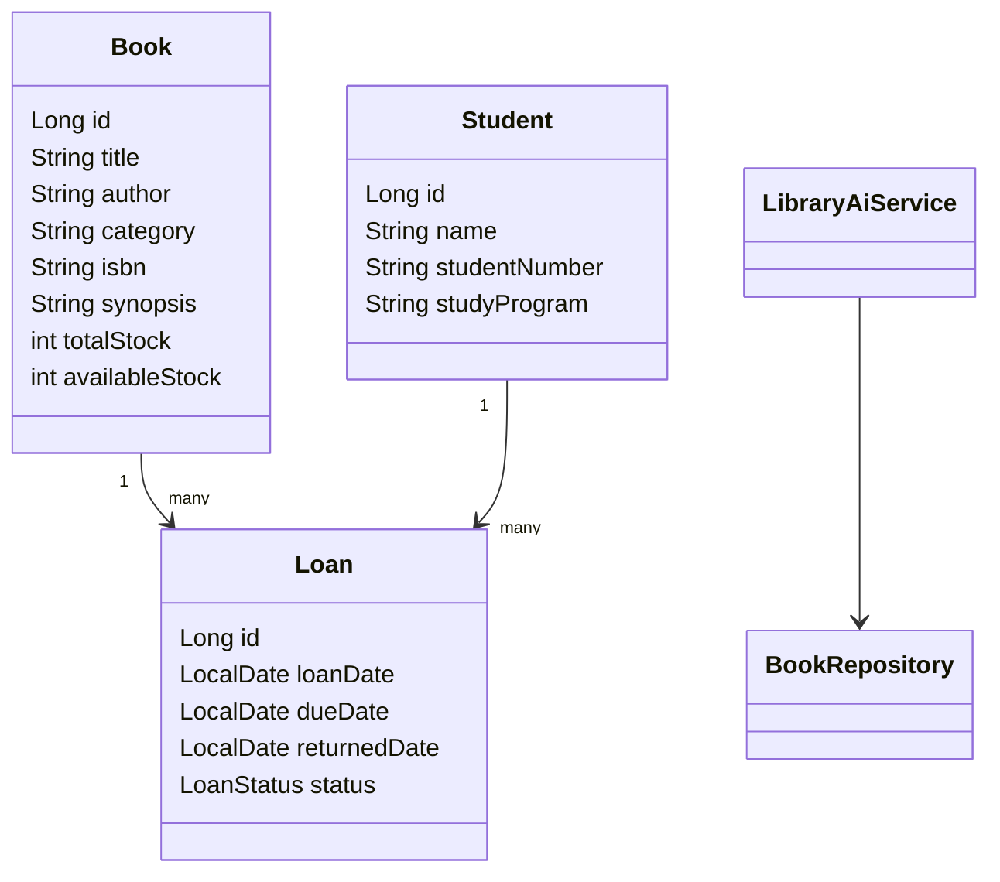
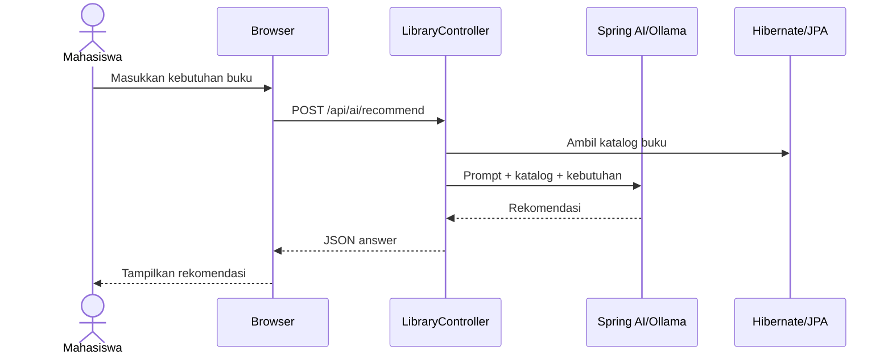
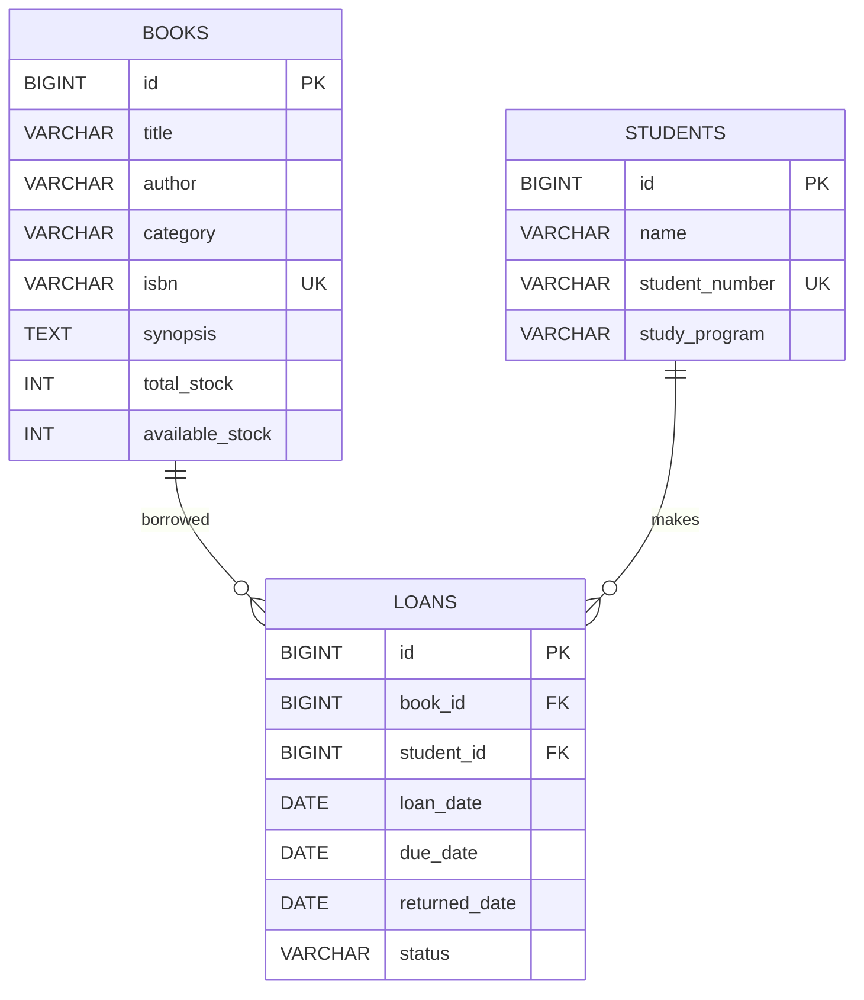

# Dokumentasi UAS: Sistem Informasi Perpustakaan

## 1. 5W + 1H

| Unsur | Penjelasan |
|---|---|
| **What** | Sistem informasi untuk mengelola katalog buku, data mahasiswa, transaksi peminjaman, pengembalian, dan layanan AI perpustakaan. |
| **Why** | Mengurangi pencatatan manual dan membantu mahasiswa menemukan buku yang sesuai kebutuhannya. |
| **Who** | Petugas perpustakaan mengelola data/transaksi; mahasiswa mencari buku dan memperoleh rekomendasi. |
| **When** | Digunakan setiap kali koleksi, anggota, atau transaksi perpustakaan perlu dikelola. |
| **Where** | Aplikasi web Spring Boot yang dapat dijalankan lokal melalui IntelliJ atau dideploy ke server. |
| **How** | REST API menerima operasi CRUD; Hibernate/JPA menyimpan data ke H2/MySQL; Spring AI mengirim katalog dan kebutuhan pemustaka ke model AI. |

## 2. Fitur aplikasi

- CRUD katalog buku: judul, penulis, kategori, ISBN, sinopsis, dan stok.
- CRUD mahasiswa: nama, NIM, dan program studi.
- Pencatatan peminjaman dengan tanggal jatuh tempo.
- Pengembalian buku dan pembaruan stok otomatis.
- Pencarian buku berdasarkan judul, penulis, atau kategori.
- Rekomendasi buku cerdas berdasarkan kebutuhan pemustaka.
- Ringkasan sinopsis otomatis menggunakan Spring AI.
- Validasi input, status transaksi, dan pesan error yang eksplisit.

## 3. Menjalankan dari IntelliJ

1. Gunakan Java 17+.
2. Pilih Run Configuration **AiStudyMentor**. Profile `mysql` memakai database MySQL `spring ai`.
3. Pastikan Ollama aktif dan model `llama3.2` tersedia (`ollama run llama3.2`).
4. Klik Run dan buka `http://localhost:8080`.

Database dibuat otomatis oleh Hibernate jika belum memiliki tabel. Jika MySQL memakai password, atur `DB_PASSWORD` sebagai environment variable. Ollama tetap berjalan lokal pada `http://localhost:11434`.

## 4. Endpoint REST

| Method | Endpoint | Fungsi |
|---|---|---|
| GET | `/api/health` | Health check |
| GET | `/api/books?q=java` | Cari/list buku |
| POST | `/api/books` | Tambah buku |
| PUT | `/api/books/{id}` | Ubah buku |
| DELETE | `/api/books/{id}` | Hapus buku |
| GET | `/api/students` | List mahasiswa |
| POST | `/api/students` | Tambah mahasiswa |
| GET | `/api/loans` | Riwayat peminjaman |
| POST | `/api/loans` | Catat peminjaman |
| POST | `/api/loans/{id}/return` | Kembalikan buku |
| POST | `/api/ai/recommend` | Rekomendasi AI |
| POST | `/api/ai/books/{id}/summary` | Ringkasan sinopsis AI |

Contoh request:

```json
{
  "title": "Spring Boot di Dunia Nyata",
  "author": "Andi Wijaya",
  "category": "Web Development",
  "isbn": "978-003",
  "synopsis": "Membangun REST API dengan Spring Boot dan JPA.",
  "totalStock": 2
}
```

## 5. Eksperimen

| Eksperimen | Langkah | Hasil |
|---|---|---|
| Katalog | Jalankan aplikasi dan buka tab Katalog Buku | Tiga data contoh tampil otomatis. |
| Pencarian | Ketik `database` | Buku Basis Data untuk Pemula tampil. |
| Peminjaman | Pilih mahasiswa, buku, dan tanggal jatuh tempo | Stok buku berkurang dan transaksi tercatat. |
| Pengembalian | Klik Kembalikan pada transaksi aktif | Status menjadi RETURNED dan stok bertambah. |
| AI rekomendasi | Isi kebutuhan belajar pada tab AI | AI memilih buku dari katalog dan memberi alasan. |
| AI ringkasan | Klik Ringkas dengan AI pada kartu buku | Sinopsis dirangkum menjadi poin-poin. |

## 6. UML





## 7. ERD


